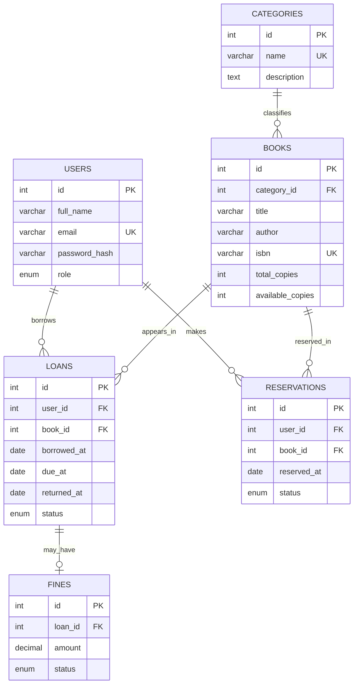

# ShelfWise — Draft ERD (Milestone 1)

The schema is a **draft**, not yet created in MySQL. Primary keys are `PK`, foreign keys `FK`. It has six entities.

## Relationships and scope
- One category has many books; each book belongs to one category.
- One user can have many loans and reservations; a loan/reservation belongs to one book.
- A loan may have zero or one fine; a fine belongs to one loan.
- `users.role` is `admin` or `member`. An admin manages library records; a member browses books and their loans/reservations.
- Later CRUD planning: users, categories, books, loans, reservations, fines each get CRUD endpoints through the REST API, subject to permissions.
- **External API planned for M3:** Open Library book search/metadata, shown on the Books page. The app must work when the API is unavailable.
